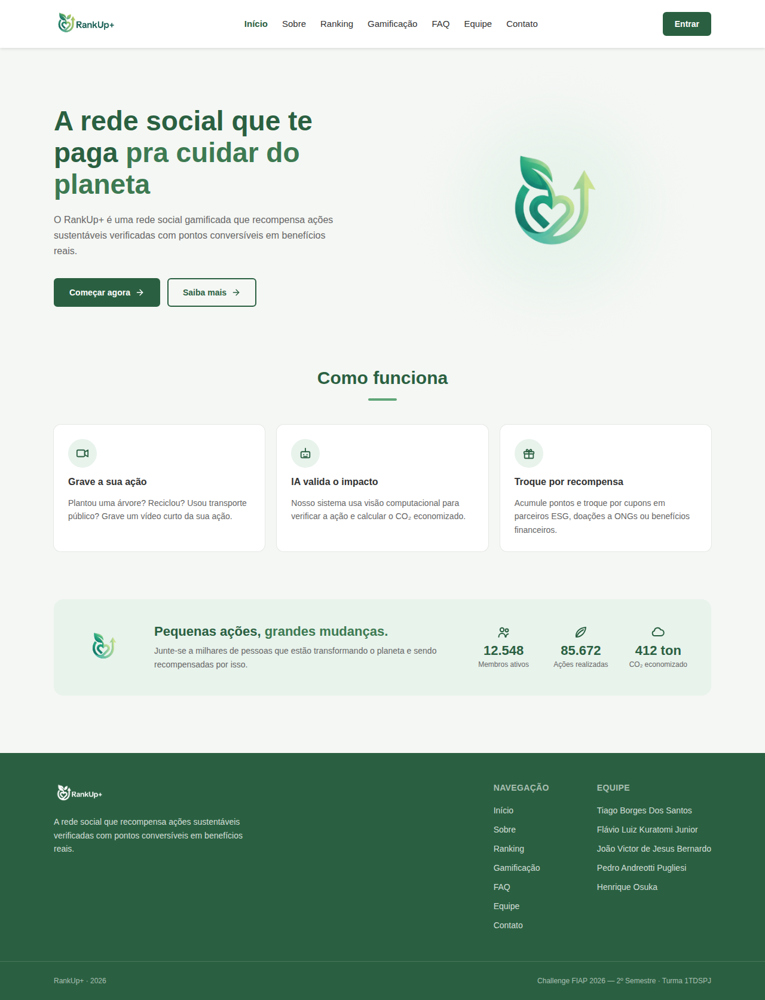
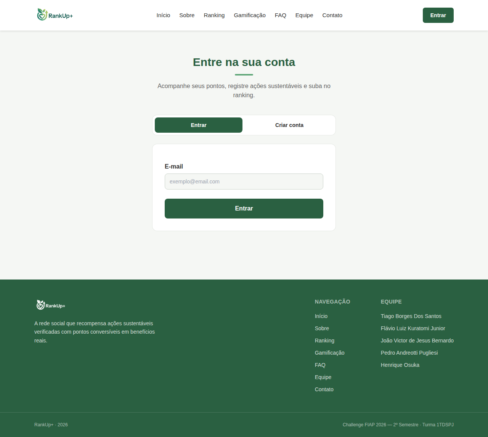
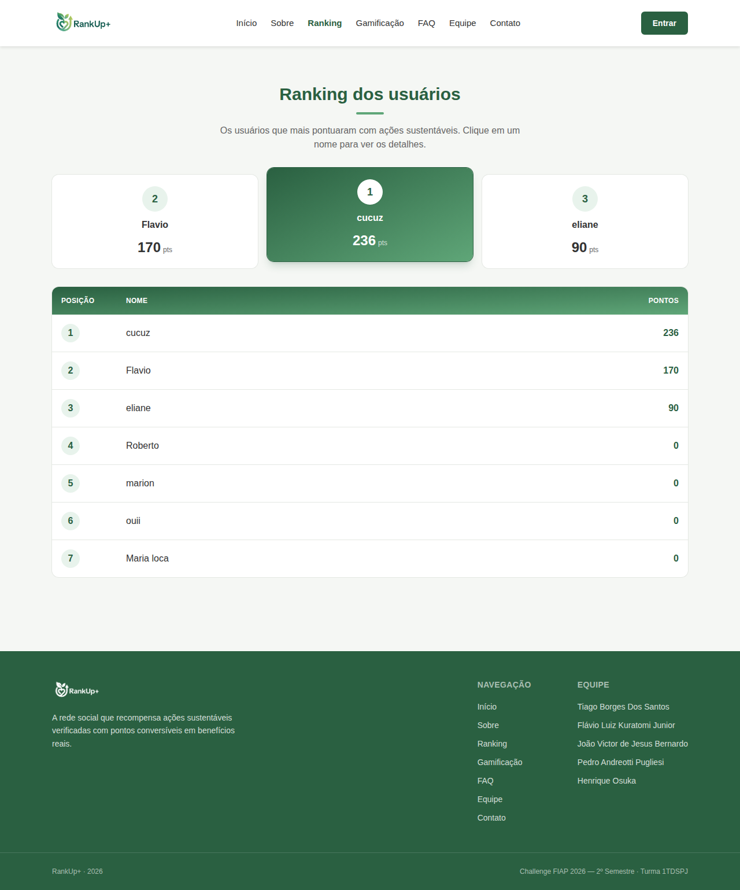
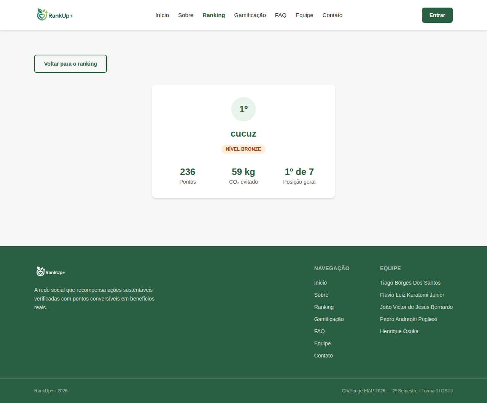
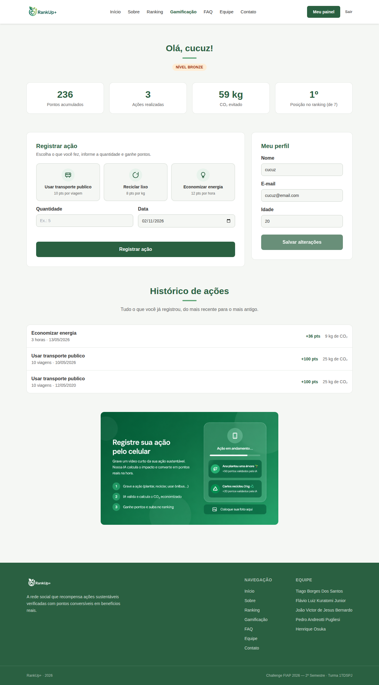
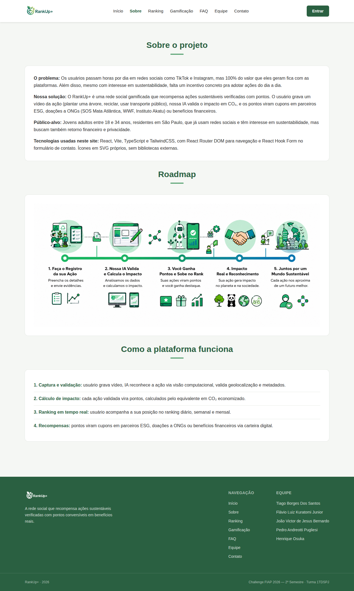
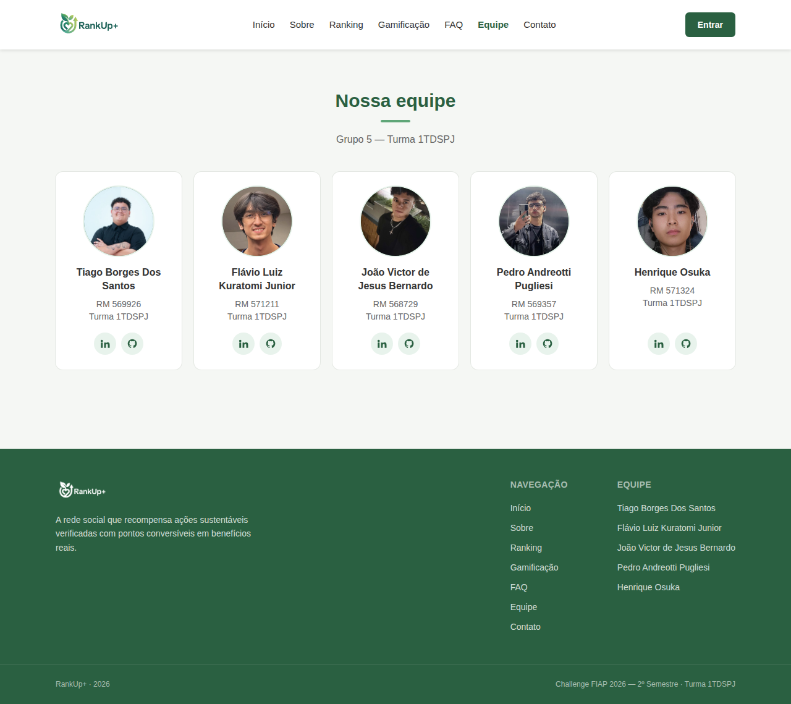
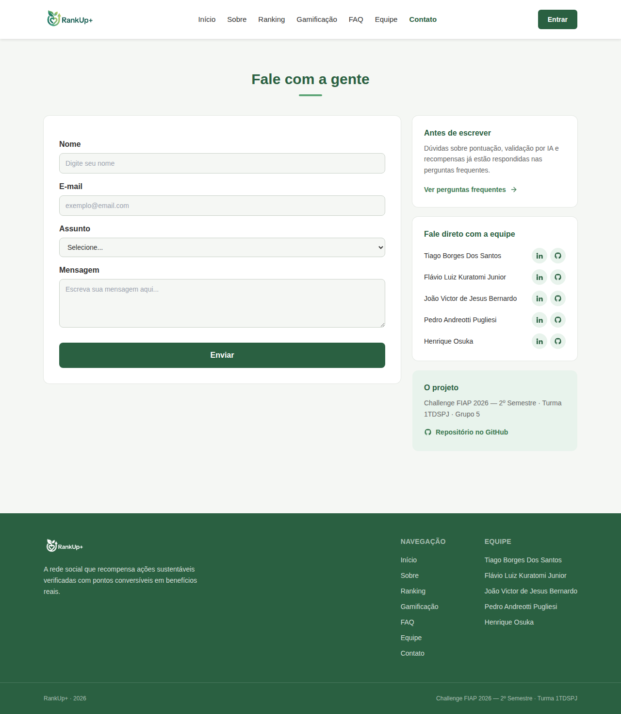

# 🌱 RankUp+ — Sistema de Gamificação Sustentável


> Projeto desenvolvido como parte do **Challenge FIAP 2026 — 2º Semestre**, em parceria com a **SoulUp**.
> **Turma 1TDSPJ · Grupo 5**

---

## 📌 Sobre o Projeto

O **RankUp+** é a interface web do **Sistema de Gamificação Sustentável** da plataforma SoulUp. O objetivo é incentivar práticas sustentáveis dentro da comunidade de usuários, transformando ações ecológicas em **pontuação justa e escalável**, com um ranking que recompensa os usuários mais engajados.

A plataforma permite que o usuário:

- 📹 Envie vídeos comprovando ações sustentáveis (plantar árvores, reciclar, usar transporte público, economizar energia)
- 🤖 Tenha a ação analisada automaticamente por visão computacional, com validação de geolocalização e metadados
- 🏆 Acumule pontos calculados pelo equivalente em CO₂ economizado
- 📊 Acompanhe seu desempenho em um ranking diário, semanal e mensal
- 🎁 Troque pontos por cupons em parceiros ESG, doações a ONGs (SOS Mata Atlântica, WWF, Instituto Akatu) ou benefícios financeiros

### Sobre esta entrega (Sprint 04)

Nesta sprint o front-end deixou de usar dados fixos e passou a **consumir a API Java** desenvolvida na disciplina de *Domain Driven Design Using Java*, publicada no Render e ligada ao banco Oracle da disciplina de *Building Relational Database*.

- 🔐 **Login e cadastro** por e-mail, com a sessão guardada em um contexto do React (`useContext`) e no `localStorage`
- 🏆 **Ranking e perfil** vindos da API, com rota dinâmica `/ranking/:id`
- 🌱 **Meu painel** com pontos, CO₂ evitado, posição e nível reais, **registro de ações** (`POST`), **histórico** e **edição de perfil** (`PUT`)
- 🛠️ **Área de administração** para listar e **excluir usuários** (`DELETE`), liberada só para administradores
- ⏳ Tratamento de **carregamento, erro e lista vazia** em todas as telas que dependem da API

A Sprint 03 tinha migrado o projeto de HTML/CSS/JavaScript para uma SPA em React + TypeScript + TailwindCSS; essa base foi mantida.

---

## 🛠️ Tecnologias Utilizadas

| Tecnologia | Versão | Finalidade |
|------------|--------|------------|
| **React** | 18.3 | Biblioteca de interface, componentização e estado |
| **Vite** | 5.4 | Build tool e servidor de desenvolvimento |
| **TypeScript** | 5.6 | Tipagem estática  |
| **TailwindCSS** | 3.4 | Estilização por classes utilitárias e design tokens |
| **React Router DOM** | 6.26 | Roteamento da SPA, incluindo rotas dinâmicas |
| **React Hook Form** | 7.53 | Formulários (contato, login, cadastro, registro de ação, perfil) e validações |
| **Fetch API** | nativa | Requisições HTTP para a API Java |
| **API Java (Spring Boot)** | — | Back-end do projeto, publicado no Render |
| **Vercel** | — | Hospedagem do front-end |
| **Git & GitHub** | — | Versionamento, branches por feature e colaboração |

> ⚠️ O projeto **não usa nenhuma biblioteca de componentes de UI** (Bootstrap, Material UI, shadcn/ui, etc.) nem biblioteca de ícones. Todos os ícones são componentes de SVG inline escritos à mão em `src/components/icons/`. As requisições usam o **`fetch` nativo do navegador**, sem Axios ou outra biblioteca HTTP.

---

## 🚀 Como Executar o Projeto

**Pré-requisito:** Node.js 18 ou superior.

```bash
# 1. Clone o repositório
git clone https://github.com/RankUp-TDSPJ/RankUp-Front.git

# 2. Acesse a pasta do projeto
cd RankUp-Front

# 3. Instale as dependências
npm install

# 4. Suba o servidor de desenvolvimento
npm run dev
```

O projeto ficará disponível em **http://localhost:5173**, já conectado à API publicada — não é preciso configurar nada.

Para apontar para outra API (por exemplo, rodando na sua máquina), copie `.env.example` para `.env.local` e ajuste a variável `VITE_API_URL`.

### Outros comandos

```bash
npm run build     # build de produção (roda o type-check antes)
npm run preview   # serve o build de produção localmente
```

---

## 📁 Estrutura de Pastas

```
RankUp-Front/
│
├── index.html                    # entrada do Vite (raiz do projeto)
├── package.json
├── package-lock.json
├── vite.config.ts
├── tsconfig.json
├── tsconfig.node.json
├── tailwind.config.js            # breakpoints, paleta e animações
├── postcss.config.js
├── vercel.json                   # faz as rotas da SPA funcionarem ao recarregar na Vercel
├── .env.example                  # URL da API (opcional)
├── .gitignore
├── README.md
│
├── public/
│   └── img/                      # logo, fotos da equipe e imagens do projeto
│       └── prints/               # prints das telas usados nesta documentação
│
└── src/
    ├── main.tsx                  # ponto de entrada: BrowserRouter + AuthProvider
    ├── App.tsx                   # rotas da aplicação (públicas, protegidas e de admin)
    ├── index.css                 # único CSS do projeto (diretivas do Tailwind)
    │
    ├── services/                 # camada de integração com a API
    │   ├── api.ts                # fetch base: URL, JSON, erros e cancelamento
    │   ├── usuarioService.ts     # cadastro, login, perfil, edição e rotas de admin
    │   ├── registroService.ts    # ações disponíveis, registro e histórico
    │   └── rankingService.ts     # ranking e posição do usuário
    │
    ├── contexts/
    │   └── AuthContext.tsx       # usuário logado, entrar, cadastrar e sair
    │
    ├── hooks/                    # useAuth, useRequisicao, useDocumentTitle, useScrollLock
    │
    ├── components/
    │   ├── layout/               # Header, Footer, Layout, MobileMenu, MensagemDaRota
    │   ├── ui/                   # Button, Card, Alerta, Carregando, ErroCarregamento,
    │   │                         # EstadoVazio, NivelBadge, SectionTitle, ImageZoom
    │   ├── auth/                 # LoginForm, CadastroForm, RotaProtegida
    │   ├── gamificacao/          # RegistrarAcaoForm, HistoricoAcoes, EditarPerfilForm,
    │   │                         # ActionPicker, PointsResult, StatCard
    │   ├── ranking/              # RankingTable, RankingRow, PodiumCard
    │   ├── admin/                # UsuarioAdminItem
    │   ├── forms/                # ContatoForm, FormField, estilos e regras de validação
    │   ├── icons/                # 17 ícones em SVG inline + índice e tipos
    │   ├── faq/                  # FaqAccordion, FaqItem
    │   ├── integrantes/          # MemberCard
    │   └── contato/              # ContatoInfo
    │
    ├── pages/                    # uma página por rota (Home, Ranking, Gamificacao, Admin...)
    ├── types/
    │   ├── api.ts                # tipos das requisições e respostas da API
    │   └── index.ts              # tipos internos do front
    ├── utils/
    │   └── formatadores.ts       # números, CO₂, datas e níveis
    └── data/                     # conteúdo fixo: integrantes e FAQ
```

---

## 🧭 Rotas da Aplicação

| Rota | Página | Tipo | Acesso |
|------|--------|------|--------|
| `/` | Home | estática | público |
| `/sobre` | Sobre o projeto | estática | público |
| `/ranking` | Ranking dos usuários | estática | público |
| `/ranking/:id` | Perfil público do usuário | **dinâmica** | público |
| `/entrar` | Login e cadastro | estática | público |
| `/gamificacao` | Meu painel: registrar ações, histórico e perfil | estática | 🔒 logado |
| `/admin` | Administração de usuários | estática | 🔒 admin |
| `/faq` | Perguntas frequentes | estática | público |
| `/integrantes` | Equipe | estática | público |
| `/integrantes/:slug` | Detalhe do integrante | **dinâmica** | público |
| `/contato` | Formulário de contato | estática | público |
| `*` | Página 404 | fallback | público |

**Redirecionamentos com mensagem:** quem abre uma rota 🔒 sem login vai para `/entrar` (e volta para onde queria depois de entrar); quem não é admin e abre `/admin` volta para o painel; um `/ranking/:id` inexistente volta para o ranking com o aviso *"Não encontramos esse usuário"*.

---

## 🔌 Integração com a API

Todas as chamadas ficam em `src/services/` — nenhum componente usa `fetch` diretamente. As respostas são tipadas em `src/types/api.ts`, e o hook `useRequisicao` devolve o estado da tela como `carregando | sucesso | erro`, para que toda página trate os três casos.

| Método | Endpoint | Onde é usado |
|--------|----------|--------------|
| `POST` | `/usuarios` | Cadastro (`/entrar`) |
| `POST` | `/login` | Login (`/entrar`) |
| `GET` | `/usuarios/{id}` | Perfil no detalhe do ranking e no painel |
| `PUT` | `/usuarios/{id}` | Edição de perfil no painel |
| `GET` | `/acoes` | Ações disponíveis, pontos e fator de CO₂ |
| `POST` | `/usuarios/{id}/registros` | Registro de ação no painel |
| `GET` | `/usuarios/{id}/registros` | Histórico de ações no painel |
| `GET` | `/ranking?limite=10` | Página de ranking |
| `GET` | `/usuarios/{id}/posicao` | Posição no detalhe do ranking e no painel |
| `GET` | `/usuarios` | Lista de usuários (admin) |
| `DELETE` | `/usuarios/{id}` | Exclusão de usuário (admin) |

> A API roda no plano gratuito do Render, que desliga o servidor sem uso. O **primeiro acesso pode levar alguns segundos** — as telas avisam isso enquanto carregam.

---

## 🖼️ Imagens e Ícones do Sistema

### Página Inicial



Tela de entrada com o conceito da plataforma — *"A rede social que te paga pra cuidar do planeta"* —, a seção **Como funciona** e o bloco de impacto coletivo. O botão **Entrar** no cabeçalho leva ao login.

### Login e Cadastro



Abas **Entrar** e **Criar conta**. O login é só por e-mail; os erros da API (e-mail não encontrado, e-mail já cadastrado) aparecem no próprio formulário.

### Ranking dos Usuários



Pódio e tabela com os 10 usuários que mais pontuaram, vindos de `GET /ranking`. Quem está logado vê a própria linha destacada com a marca **Você**. Clicar em um nome abre o perfil.

### Perfil no Ranking



Rota dinâmica `/ranking/:id`, com nível, pontos, CO₂ evitado e posição geral do usuário.

### Gamificação — Meu Painel



Pontos, ações realizadas, CO₂ evitado e posição reais; formulário para **registrar uma ação** com prévia dos pontos; **edição de perfil**; e o **histórico** de ações do mais recente para o mais antigo.

### Sobre o Projeto



Problema, solução, público-alvo e o roadmap da plataforma. As imagens têm zoom ao clique (fecha com `Esc` ou clique fora).

### Equipe



Cards dos cinco integrantes, com link para a página de detalhe de cada um.

### Contato



Formulário validado com React Hook Form, ao lado de um bloco com atalho para o FAQ, os contatos da equipe e o link do repositório.

---

## 🔗 Como Usar

| | Link |
|---|---|
| 📂 **Repositório no GitHub** | [https://github.com/RankUp-TDSPJ/RankUp-Front](https://github.com/RankUp-TDSPJ/RankUp-Front) |
| 🌐 **Aplicação na Vercel** | [https://rank-up-front.vercel.app](https://rank-up-front.vercel.app) |
| 🎥 **Vídeo no YouTube** | _a adicionar_ |
| ⚙️ **API Java (Render)** | [https://rankup-java.onrender.com](https://rankup-java.onrender.com) — exemplo: [`/acoes`](https://rankup-java.onrender.com/acoes) |

**Testando a aplicação:**

1. Abra a aplicação na Vercel e clique em **Entrar → Criar conta** (nome, e-mail e idade).
2. No **Meu painel**, escolha uma ação, informe a quantidade e clique em **Registrar ação** — os pontos, o CO₂ e a posição atualizam na hora.
3. Veja seu nome no **Ranking** e edite seus dados em **Meu perfil**.
4. Para a área de **Admin**, entre com uma conta de administrador.

---

## 👥 Autores

Projeto desenvolvido pelo **Grupo 5 — Turma 1TDSPJ** (FIAP — Análise e Desenvolvimento de Sistemas):

<table>
  <tr>
    <td align="center" width="180">
      <br />
      <strong>Tiago Borges Dos Santos</strong><br />
      RM 569926<br />
      Turma 1TDSPJ<br />
      <a href="https://www.linkedin.com/in/tiago-borges-2251933a6">LinkedIn</a> ·
      <a href="https://github.com/tiagostnz">GitHub</a>
    </td>
    <td align="center" width="180">
      <br />
      <strong>Flávio Luiz Kuratomi Junior</strong><br />
      RM 571211<br />
      Turma 1TDSPJ<br />
      <a href="https://www.linkedin.com/in/flavio-luiz-kuratomi-junior-7878ab317/">LinkedIn</a> ·
      <a href="https://github.com/kkuras">GitHub</a>
    </td>
    <td align="center" width="180">
      <br />
      <strong>João Victor de Jesus Bernardo</strong><br />
      RM 568729<br />
      Turma 1TDSPJ<br />
      <a href="https://www.linkedin.com/in/joaovjbernardo/">LinkedIn</a> ·
      <a href="https://github.com/joaovjbernardo">GitHub</a>
    </td>
    <td align="center" width="180">
      <br />
      <strong>Pedro Andreotti Pugliesi</strong><br />
      RM 569357<br />
      Turma 1TDSPJ<br />
      <a href="https://www.linkedin.com/in/pedro-andreotti-8270a3404/">LinkedIn</a> ·
      <a href="https://github.com/PedroAndreottiPugliesi">GitHub</a>
    </td>
    <td align="center" width="180">
      <br />
      <strong>Henrique Osuka</strong><br />
      RM 571324<br />
      Turma 1TDSPJ<br />
      <a href="https://www.linkedin.com/in/henrique-osuka-78a0993b5/">LinkedIn</a> ·
      <a href="https://github.com/HenriqueOsuka">GitHub</a>
    </td>
  </tr>
</table>

---

## 📬 Contato da Equipe

Para falar sobre o projeto, tirar dúvidas ou propor parcerias:

- 💬 **Pelo site:** a página [Contato](src/pages/Contato.tsx) tem um formulário e os contatos diretos de cada integrante
- 💼 **LinkedIn e GitHub:** os perfis de todos os integrantes estão na tabela de [Autores](#-autores) acima
- 📂 **Issues do repositório:** [abrir uma issue](https://github.com/RankUp-TDSPJ/RankUp-Front/issues) para relatar problemas ou sugerir melhorias
- 🎓 **Instituição:** FIAP — Análise e Desenvolvimento de Sistemas · Turma 1TDSPJ · Grupo 5

---

## 📱 Responsividade

A interface é **mobile-first** e foi verificada nos breakpoints configurados em `tailwind.config.js`:

| Breakpoint | Largura | Comportamento |
|------------|---------|---------------|
| base | até 479px | conteúdo em coluna única, menu hambúrguer |
| `sm` | 480px | ajustes de tipografia e cards em 2 colunas |
| `md` | 768px | seções lado a lado, grids intermediários |
| `lg` | 992px | menu de navegação completo no header |
| `xl` | 1280px | layout mais espaçado, equipe em 5 colunas |

A interface também respeita `prefers-reduced-motion`: todas as transições e animações são desligadas para quem prefere menos movimento, e todo elemento interativo tem indicador de foco visível para navegação por teclado.

---

## 📄 Licença

Projeto desenvolvido para fins acadêmicos, como parte do **Challenge FIAP 2026 — 2º Semestre**, em parceria com a SoulUp.

---

<p align="center">
  Feito com 💚 pelo time <strong>RankUp+</strong> — FIAP 2026
</p>
